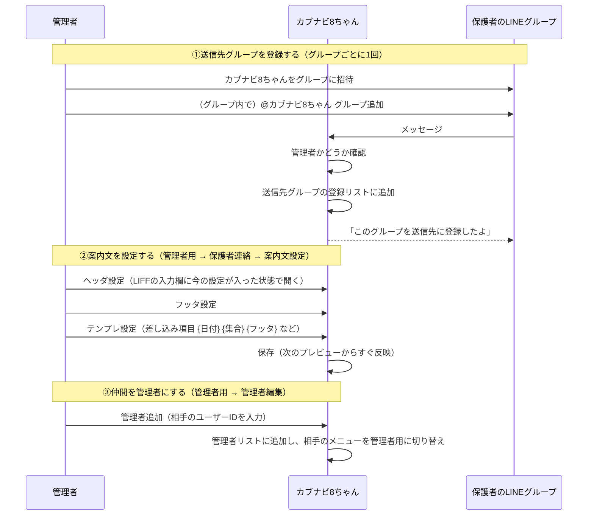
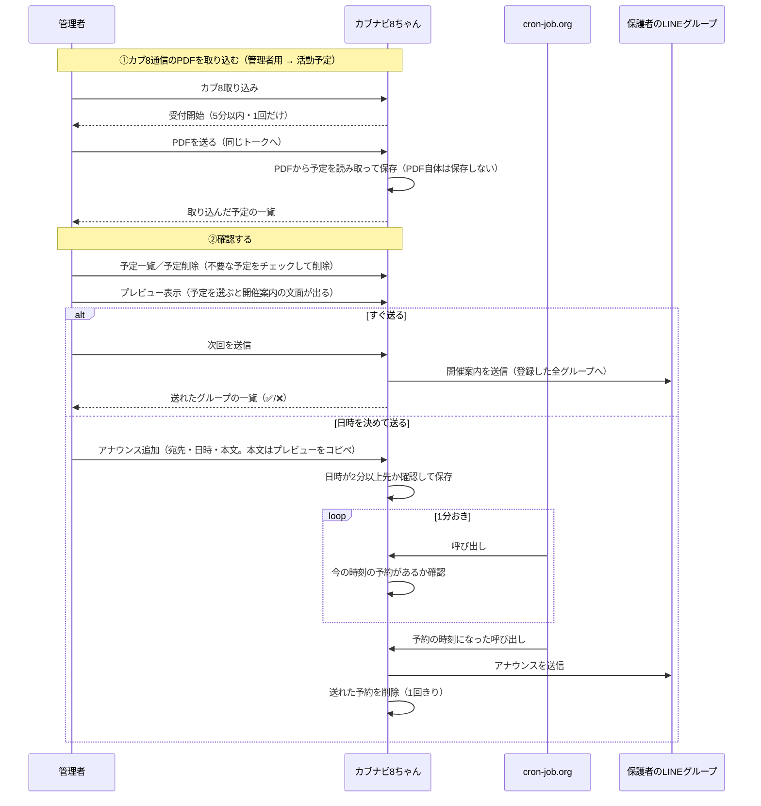
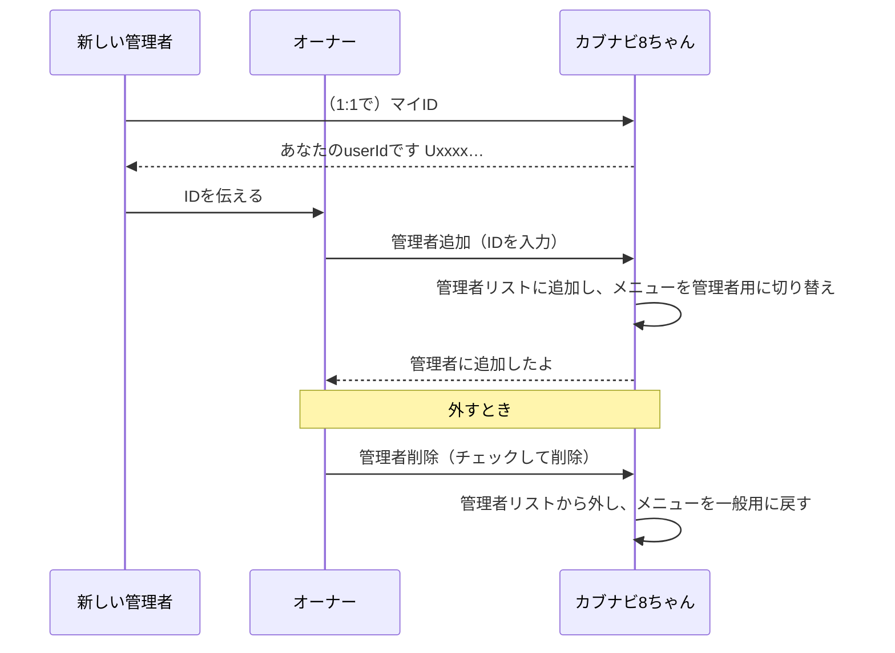
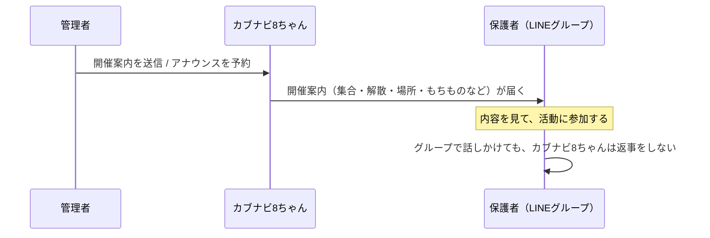

# ユースケース: カブナビ8ちゃんの使い方（役割別）

カブ隊用LINEボット「カブナビ8ちゃん」を、**誰が・いつ・何をするか**で整理したもの。
機能どうしのつながりは、[しくみ図（overview.html）](https://koichi210.github.io/stable/doc/line-bot-s8-cub/overview.html)で見られます。
メニューを押しながらの手順は、[管理者向けチュートリアル](https://koichi210.github.io/stable/doc/line-bot-s8-cub/tutorial-admin.html)を参照してください。

> 掲載している人名・グループ名・IDは、すべてダミーです。

## 登場人物

| 誰 | 役割 |
|---|---|
| 🧑‍💼 管理者 | リッチメニューで操作する指導者。複数人いてよい。最初の1人が**オーナー** |
| 💬 保護者 | 開催案内・アナウンスをLINEグループで受け取る人。**操作は不要** |
| 🤖 カブナビ8ちゃん | 管理者の操作に反応して、予定の保存・案内文の作成・送信をするBot |
| ⏰ cron-job.org | 毎分Botを呼び出して、アナウンス予約の時刻を知らせる目覚まし役 |

---

## 1. 管理者が「最初に」やること

最初の1回だけ行う準備です（あとは毎月の作業だけ）。

1. **オーナーを決める**（最初の管理者。Botの設定で指定済みなので、通常は作業なし）
2. **送信先グループを登録する**
3. **案内文（ヘッダ・フッタ・テンプレ）を設定する**
4. （必要なら）**仲間を管理者に追加する**

### チェックリスト

- [ ] 保護者のLINEグループに、カブナビ8ちゃんを招待した
- [ ] そのグループの中で「グループ追加」を送って、登録できた
- [ ] 「グループ一覧」で、登録されていることを確認した
- [ ] ヘッダ・フッタ・テンプレを設定した（プレビュー表示で文面を確認できる）
- [ ] 手伝ってもらう人がいれば、管理者に追加した（本人が1:1で「マイID」と送ってIDを教えてもらう）

### ポイント

- 「グループ追加」は**グループの中で**、**管理者が**カブナビ8ちゃんに@メンションして送ります。1:1トークでボタンを押しても登録はできません。
- 同じグループに別のBot（ミライなど）が入っていると、招待が止まることがあります。
- ヘッダ・フッタ・テンプレは**一度決めれば使い回せます**。毎月触るのは予定（PDF）だけです。

---

## 2. 管理者が「開催案内を出すとき」（毎月）

カブ8通信が届いたら、PDFを取り込み、確認してから送ります。**送り方は2通り**です。

- **すぐ送る**: チャットで「次回を送信」
- **日時を決めて送る**: アナウンスを予約（時刻になると自動で届く）

### 毎月の手順（チェックリスト）

- [ ] 管理者用 → 活動予定 →「カブ8取り込み」を押し、**5分以内に**PDFを送った
- [ ] 取り込み結果（追加・上書きの件数）を確認した
- [ ] 不要な予定は「予定削除」でチェックして消した
- [ ] 保護者連絡 → 案内文設定 →「プレビュー表示」で、送る予定を選んで文面を確認した
- [ ] **すぐ送る**なら「次回を送信」／**日時を決める**なら「アナウンス追加」で予約した
- [ ] 予約した場合は、「アナウンス一覧」で内容を確認した（取り消しは「アナウンス削除」）

### ポイント

- 取り込めるのは、「カブ8取り込み」と合図した**本人**が、**同じトーク**へ送った**PDF**だけです。合図の無いファイルや画像は無視されます。
- 同じ日付・タイトルの予定は上書きされます。日付が過ぎた予定は、一覧やプレビューを開いたときに自動で消えます。
- アナウンスの日時は**2分以上先**を指定します。送れた予約は自動で消え、失敗した分は残って次の呼び出しで再送されます。
- 時刻になったかを判断しているのはBot側で、cron-job.orgは毎分呼び出すだけの目覚まし役です。

---

## 3. 管理者を増やす・減らすとき

- 管理者の**追加**は管理者ならだれでも、**削除はオーナーだけ**できます（事故防止）。
- オーナーは常に管理者で、外せません。

---

## 4. 保護者がやること

**操作は不要です。**グループに届くお知らせを見るだけで大丈夫です。

- 届いた**開催案内**を見て、集合時間・場所・もちものを確認します。
- アナウンスは、管理者が決めた**日時に自動で**届きます。
- カブナビ8ちゃんは**管理者の操作だけ**に反応します。保護者がグループで話しかけても返事はしません（質問は、これまでどおり指導者に直接）。
- 1:1トークの「ヘルプ」ボタンは、今は「今後実装予定です」と返ります。保護者向けの機能は、これから追加していく予定です。
- 管理者として手伝うことになったら、1:1で「マイID」と送り、返ってきたIDをオーナーに伝えます（上の3）。

---

## こんなときは

| 困りごと | 確認すること |
|---|---|
| 開催案内を送ったのに、グループに届かない | グループが「送信先グループ」に登録されているか（グループ一覧）。登録は**そのグループの中**で「グループ追加」 |
| PDFを送っても取り込まれない | 先に「カブ8取り込み」を押したか。**5分以内**か。**同じトーク**へ**PDF**を送ったか |
| 「次回」の予定がない | 取り込み済みの予定が、今日以降のものか（過ぎた予定は自動で消える）。PDFを取り込み直す |
| プレビューにフッタが出ない | テンプレに `{フッタ}` が入っているか（テンプレ設定で確認。初期化すると既定に戻る） |
| アナウンスが予約できない | 日時が**2分以上先**か。送信先グループが登録されているか |
| 予約した時刻に届かない | 「アナウンス一覧」にまだ残っているか。cron-job.org が毎分呼び出せているか |
| メニューが管理者用にならない | 管理者に追加されているか。トークを開き直す。管理者追加をやり直す |
